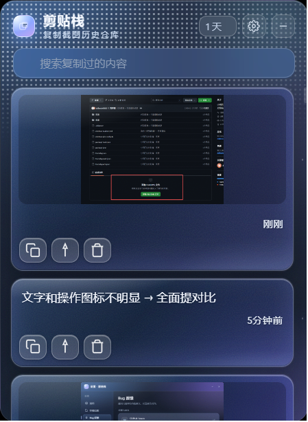
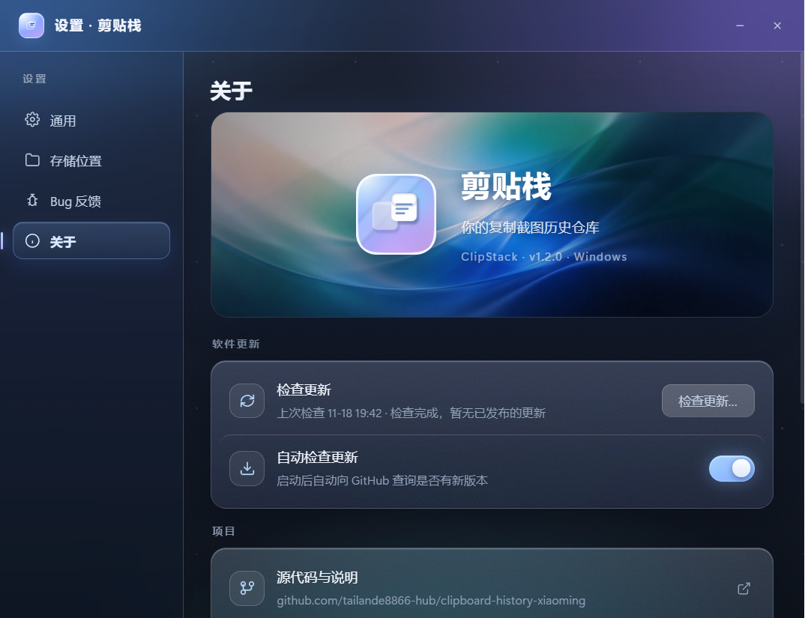
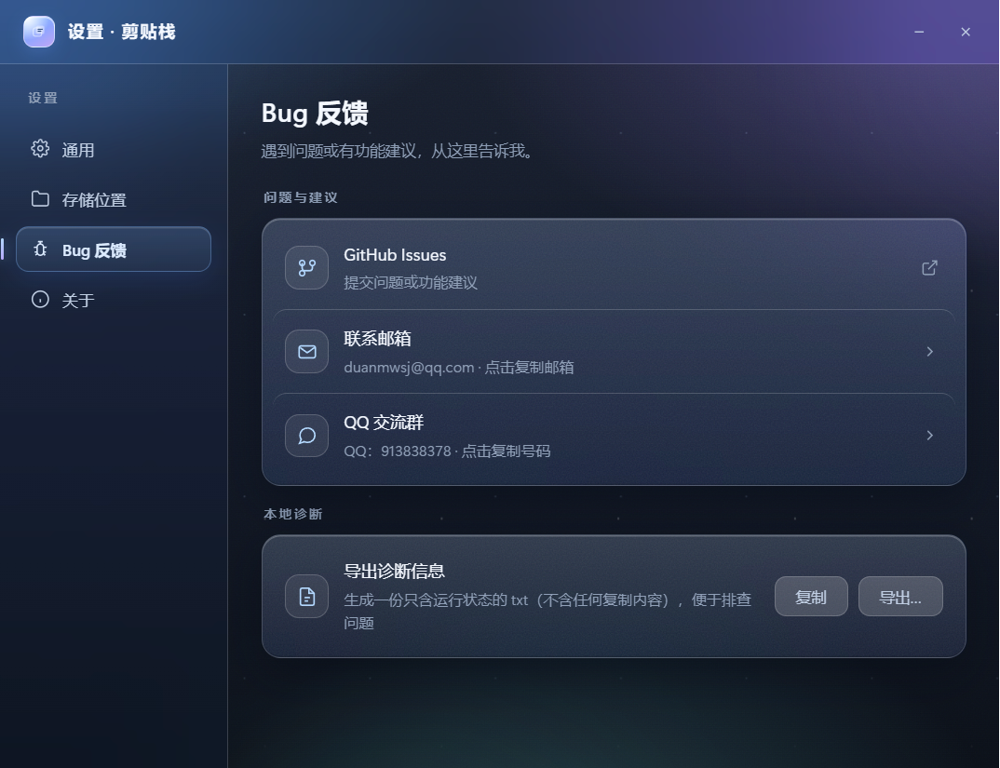

# 剪贴栈 · ClipStack

> **你的复制截图历史仓库。**

一个 Windows 桌面剪贴板历史工具。复制过的文字、截图都会被自动收进这口「栈」里，随时翻回去取用——不用再到处粘贴试探，也不怕刚截的图被下一次复制顶掉。



<p align="center">
  
  
</p>

---

## 它解决什么问题

- 刚截的图、刚复制的代码，被下一次复制顶掉了？→ 历史列表里翻回来，**点一下即复制**。
- 想找回 3 小时前复制的一段命令？→ 搜索框直接搜。
- 常用片段不想每次重新敲？→ **置顶**，永远排在最上面。
- 记录越攒越多怕占地方？→ 保留时长可选，图片单独落盘，超期自动清理。

## 功能

| 功能 | 说明 |
| --- | --- |
| 文本 + 图片历史 | 文本、截图、复制的图片统一入库，图片单独存文件，不撑爆数据库 |
| 一键复制 | **点击卡片 = 直接把这条件放回剪贴板**，右下角弹「已复制」提示 |
| 置顶 | 把常用片段钉在顶部，不受时间排序影响 |
| 搜索 | 输入关键词即时过滤，支持中文 |
| 保留时长 | **2 小时 / 4 小时 / 6 小时 / 1 天 / 3 天 / 7 天 / 永久**，按小时定时清理，置顶记录永不清理 |
| 悬浮球 | 桌面常驻一颗带呼吸光环的小球（粒子爆炸 + 3.4s 呼吸），点一下唤出面板 |
| 托盘常驻 | 托盘图标 + 右键菜单，关掉窗口也不丢功能 |
| 全局快捷键 | `Ctrl + Shift + V` 随时唤出面板 |
| 开机自启 | 可在设置里开关 |
| 存储位置自定义 | 数据目录可迁移到其他磁盘（改名 / 重装都不丢历史） |
| 检查更新 | 启动后自动向 GitHub 查询新版本，也可手动检查 |
| 本地诊断 | 一键导出只含运行状态的诊断文本，反馈问题时不泄露剪贴板内容 |

## 安装

### 方式一：下载压缩包（推荐）

到 [Releases](https://github.com/tailande8866-hub/ClipStack/releases/latest) 下载最新的 `ClipStack-*-x64.zip`，解压到任意目录（例如 `D:\ClipStack`），双击 `剪贴栈.exe` 即可运行，无需安装。

> 首次启动 Windows SmartScreen 可能提示「未知发布者」，点「更多信息 → 仍要运行」即可（个人项目没有代码签名证书）。

### 方式二：从源码运行

```powershell
git clone https://github.com/tailande8866-hub/ClipStack.git
cd ClipStack
npm install
npm run dev
```

环境要求：Node.js ≥ 18、Windows 10/11。

## 使用

1. 启动后会看到桌面上的悬浮球（或托盘图标），左键点球唤出面板。
2. 面板里从上到下就是你的历史：**最新的在最上面**。
3. 想取回某条 → 点卡片；想留个位置 → 点图钉置顶；不想要了 → 点垃圾桶，**一次点击直接删除**（不再二次确认）。
4. 顶部那个下拉是保留时长（最短 2 小时，可选永久）；齿轮进设置，`—` 是最小化。
5. 快捷键 `Ctrl + Shift + V` 可以不用点球直接唤出。

## 数据

默认位置：`%APPDATA%\clipboard-history`

```
clipboard-history\
├─ data.db       记录数据库
└─ images\       图片文件（按 hash 存放）
```

改名、重装、升级都不会动这个目录，历史不会丢。可在「设置 → 存储位置」迁移。

## 更新机制

- 程序在「设置 → 关于」里点「检查更新」，会读取本仓库的 **最新 Release**（标签 + 正文说明），版本号比本机高就提示有新版本。
- **v1.3.22 起**：启动约 8 秒后自动静默检查一次；一旦发现比本机新的版本，直接弹出**更新说明弹窗**（内容是这次 Release 的正文，过长可在弹窗里上下滚动），底部只有「更新」「关闭」两个按钮；点关闭会记住该版本，同一版本下次启动不再重复弹。
- **一键静默更新**：点「更新」后程序自己下载 Release 里的 zip（先走国内加速通道，失败再回退 GitHub 直连，下完按 GitHub 给的 sha256 校验），解压后退出，由一段计划任务脚本把新文件覆盖到安装目录，最后自动重启；下载过程有进度条，记录与设置全部保留。
- 设置页「关于 → 软件更新」只保留「检查更新…」和「自动检查更新」开关；发现新版本时同样直接弹更新说明弹窗，不再显示整块更新卡片。
- 因此：**只有发 Release（并带上 zip 附件）才会被识别为一次正式更新**，光推代码不会触发提示。
- 如果安装目录没有写权限（例如放在 `Program Files`），自动更新会失败并给出提示，此时用「查看更新说明」到 Release 页手动下载覆盖即可。
- 完整版本历史见 [CHANGELOG.md](CHANGELOG.md)。

## 技术栈

- Electron 33 + TypeScript + React + Vite
- 主进程：剪贴板监听、SQLite 存储、托盘 / 悬浮球 / 全局快捷键 / 单实例锁
- 渲染层：原生 CSS 手写玻璃拟态（`backdrop-filter` + 噪点 + 呼吸光 + 点阵 + 扫光），不依赖 UI 框架主题

## 打包

```powershell
npm run build          # 编译
npm run package:dir    # 免安装目录版 → dist\win-unpacked
npx electron-builder --win zip   # 便携压缩包 → dist\ClipStack-1.2.0-x64.zip
```

图标由 `tools/make-icon3d.py`（主程序）与 `tools/make-tray-icon.py`（托盘小图标）生成，需要 Python + Pillow。

## 反馈

- GitHub Issues：<https://github.com/tailande8866-hub/ClipStack/issues>
- 邮箱：duanmwsj@qq.com
- QQ：913838378

## License

MIT


